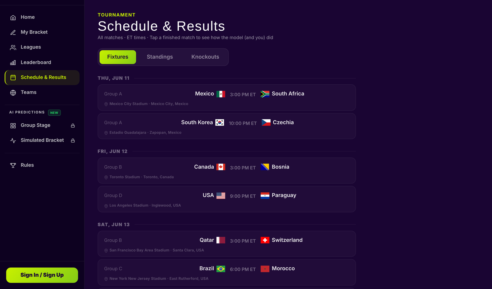
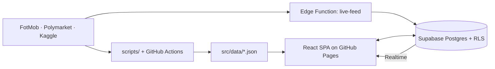

# World Cup 2026 Predictor

A full-stack web app for predicting 2026 FIFA World Cup matches. A trained model forecast every game, users submitted their own picks, and private leagues competed on a live leaderboard. Built 50/50 by Mark Hanna and Karim Assaad.

**Live site:** [worldcup26-lemon-five.vercel.app](https://worldcup26-lemon-five.vercel.app/) · **120+ users across 8 leagues** during the tournament

This repo is Mark's copy of the project, deployed at [markhanna10.github.io/world-cup-2026-predictor](https://markhanna10.github.io/world-cup-2026-predictor/). The original lives at [TheCoolKar/world-cup-predictor](https://github.com/TheCoolKar/world-cup-predictor).

**Status:** the tournament ended on 19 July 2026 with Spain beating Argentina 1–0 in the final. Picks are closed and the data is frozen. The model's predictions stay open to everyone, no account needed.



## Highlights

- **Prediction model.** Logistic regression trained on 2,448 decisive international matches since 2000. Features: ELO gap, recent form, head-to-head record, attack and defence ratings. 68.6% accuracy under 5-fold cross-validation. During the tournament, predictions frozen before kickoff picked the right result in 29 of 43 group matches (67%), counting draws as misses since the model never predicts a draw.
- **Tournament simulation.** 10,000 Monte Carlo runs of the full bracket produce each team's odds of reaching every round.
- **Live scores.** A Supabase Edge Function polls match data every minute through `pg_cron` and pushes goals, cards and subs to the browser over Realtime. No client polling.
- **Picks and leagues.** Email, magic link and Google sign-in. Private leagues with join codes, confidence picks, streaks and a database trigger to lock picks at kickoff.
- **Automated data pipeline.** GitHub Actions refresh form data and rerun the simulation daily, commit the new JSON and redeploy the site. The schedule is off now the tournament is over.
- **Data correction.** In this copy's database, the live feed filed several knockout scores under the wrong match numbers. A one-off correction rebuilt all 31 knockout results from two independent sources that agree on every game, and a new shootout-winner column lets penalty wins resolve the bracket.
- **Security.** Row-level security on every table. The service-role key lives only in the edge function and CI secrets.

## Tech stack

| Layer | Tools |
| --- | --- |
| Frontend | React 19, Vite, Tailwind CSS |
| Backend | Supabase: Postgres, Auth, Realtime, Edge Functions (Deno), pg_cron |
| Model | Python, scikit-learn, NumPy |
| Data | FotMob, Polymarket, Kaggle international results |
| Testing | Vitest (23 unit tests), k6 load-test scaffold |
| CI/CD | GitHub Actions, Dependabot, GitHub Pages |

## Architecture



Full details in [docs/ARCHITECTURE.md](docs/ARCHITECTURE.md).

## How the prediction works

1. `scripts/train_model.py` builds rolling features for every historical match between World Cup teams and fits a logistic regression.
2. The learned weights land in `src/data/model_weights.json`.
3. `src/utils/Predictions.js` runs the model in the browser and blends in squad strength and recent form.
4. `scripts/generateMonteCarlo.mjs` simulates the tournament 10,000 times for bracket odds.

## Run locally

```bash
git clone https://github.com/MarkHanna10/world-cup-2026-predictor.git
cd world-cup-2026-predictor
npm install
cp .env.example .env.local   # add your Supabase URL and anon key
npm run dev                  # http://localhost:5173
```

| Command | Purpose |
| --- | --- |
| `npm test` | Run unit tests |
| `npm run build` | Production build |
| `npm run sim` | Regenerate Monte Carlo odds |
| `npm run refresh:daily` | Pull recent form and rerun the simulation |
| `npm run train-model` | Retrain model weights (Python) |

## Project structure

```
src/
  pages/        Route-level views: Predict, Bracket, Leagues, Leaderboard
  components/   Match cards, bracket, live match panel, modals
  utils/        Prediction model, tournament simulator, scoring
  data/         Model inputs and precomputed simulation output
scripts/        Data pipeline and model training
supabase/       SQL migrations and Edge Functions
docs/           Architecture and key-rotation runbook
```

## Authors

Built as an equal partnership by [Mark Hanna](https://github.com/MarkHanna10) and [Karim Assaad](https://github.com/TheCoolKar).
